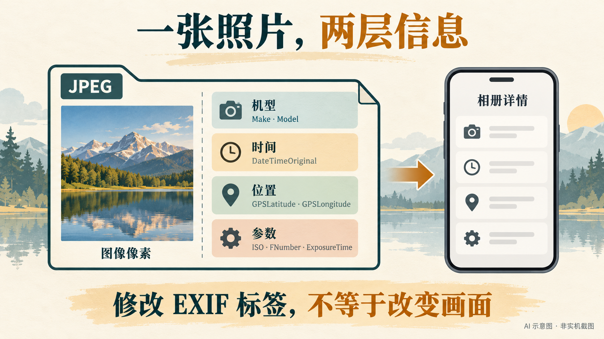
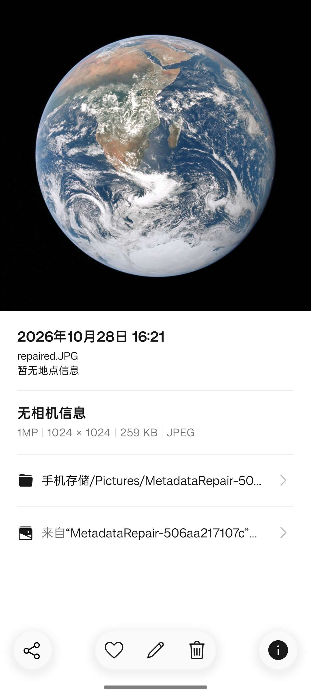
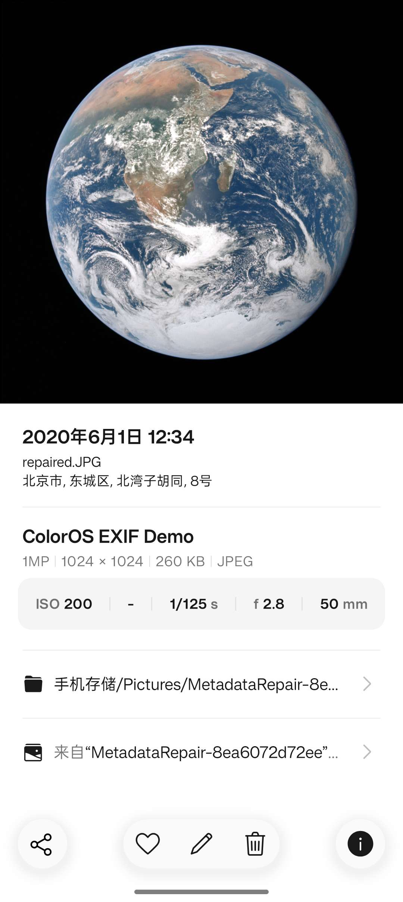

# 从 MIUI、类原生、Pixel 到一加：为了 OPPO 相册，我开始修复整个旧媒体库

换到一加之后，我原本以为，迁移照片就是把旧手机的 DCIM 复制过来。

真正打开 OPPO 相册才发现，照片都在，属于它们的那些信息却不一定还在：有些拍摄时间变成了复制时间，有些机型一栏空着，有些明明还保留着镜头名字，相册却说“无相机信息”。过去在 MIUI、类原生、Pixel 和不同相机应用之间折腾留下的文件，终于在同一个相册里碰面了。

我想整理的不是几张照片，而是一整个跨设备、跨系统的旧媒体库。这件事最后让我重新认识了 EXIF：它不是相册里可有可无的装饰，而是软件理解一张照片的重要线索。

这篇文章把我的处理方法整理成可以复用的教程。既讲怎样找回有依据的信息，也讲怎样主动设定机型、时间、定位和摄影参数，让 ColorOS 相册读到自己希望展示的内容。

## 先弄清楚：照片的画面和照片的信息，是两回事

一张 JPEG 可以同时携带图像数据和元数据。前者决定你看到什么画面；后者描述设备、拍摄时间、镜头、曝光和位置等信息。

所以，给一张图写上“Pixel 4 XL”，不会让它获得 Pixel 的成像效果；把光圈写成 f/2.8，也不会重新计算景深。它改变的是文件中的说明，软件可能据此显示详情、排序或归类。



上图是 AI 生成的结构示意，不是相册截图。下面的对比图则来自真实手机界面。

EXIF 是常见的照片元数据标准，但“照片元数据”不只 EXIF。一张文件里还可能有 XMP、IPTC 和厂商私有信息。同名字段出现在不同位置时，也不一定是同一份值。

我现在先看这几组：

| 想改什么 | ExifTool 常用字段 | 它的含义 |
| --- | --- | --- |
| 相机厂商、机型 | IFD0:Make、IFD0:Model | 例如 Google、Pixel 4 XL |
| 镜头厂商、型号 | ExifIFD:LensMake、ExifIFD:LensModel | 镜头信息，和相机机型分开 |
| 拍摄时间 | ExifIFD:DateTimeOriginal | 拍摄时的日期和时钟时间 |
| 数字化、修改时间 | ExifIFD:CreateDate、IFD0:ModifyDate | 与拍摄时间有关，但语义并非永远相同 |
| 时区、毫秒 | OffsetTimeOriginal、SubSecTimeOriginal | 为主要时间补充偏移量和亚秒 |
| 经度、纬度 | GPSLatitude、GPSLongitude 及各自 Ref | 数值与南北、东西方向要配套 |
| ISO、光圈、快门 | ISO、FNumber、ExposureTime | 例如 200、2.8、0.008 秒 |
| 实际、等效焦距 | FocalLength、FocalLengthIn35mmFormat | 两种焦距不能混为一谈 |
| 曝光补偿 | ExposureCompensation | ExifTool 对 EXIF ExposureBiasValue 的命名 |

表里的 IFD0、ExifIFD、GPS 是字段所在的分组。读写时带上分组，是为了减少“改了一个 Model，相册却读另一个 Model”的混淆。[ExifTool 的 EXIF 标签表](https://exiftool.org/TagNames/EXIF.html) 给出了这些字段的定义、分组和可写类型。

另一个容易混淆的东西是文件系统日期。Windows 资源管理器里的“修改日期”、Android 媒体库的导入时间，以及 EXIF 里的 DateTimeOriginal，分别属于不同层面。只修改文件的修改日期，不等于修好了拍摄时间。

## 先看效果：同一张公开图片，相册能读出什么

为了让对照可以公开复现，我没有使用私人照片，而是从 NASA 下载了 [Apollo 17 的“蓝色弹珠”图片](https://svs.gsfc.nasa.gov/30613/)。这份下载图没有相机与 GPS 字段，适合观察“没有信息”和“写入信息”之间的差别。

我给副本主动设定了这些值：

| 字段 | 教学设定 |
| --- | --- |
| 厂商 / 机型 | Demo / ColorOS EXIF Demo |
| 拍摄时间 / 时区 | 2020:06:01 12:34:56 / +08:00 |
| GPS | 北纬 39.9087、东经 116.3975，北京地区的公开演示坐标 |
| ISO / 光圈 / 快门 | 200 / f/2.8 / 1/125 秒 |
| 实际焦距 / 35mm 等效焦距 | 35 mm / 50 mm |
| 曝光补偿 | −0.7 EV |

这些是为了展示字段作用而设定的值，**不是这张太空照片的真实拍摄信息**。

修改前，相册显示“无相机信息”“暂无地点信息”，日期也不是 EXIF 提供的真实拍摄时间：



修改副本、复制到手机的新图集并重新打开相册后：



这次用的是一加 Ace 3V、Android 16，系统相册版本为 16.40.22。可以直接看到，自定义机型、日期、地点、ISO、光圈、快门和焦距已经出现在详情里。

有两个细节比“成功”本身更有价值。

第一，我同时写了实际焦距 35 mm 和等效焦距 50 mm，这个版本显示的是 **50 mm**。如果你改了 FocalLength，却发现界面里的焦距没按预期变化，要检查等效焦距是否还在。

第二，同一个 ExposureCompensation=−0.7 字段，在 ACE 3V 上读回正常但界面显示“−”；后续一加 15 的实机截图则明确显示 ev −0.7，而且普通静态对照图也能显示。这是相册显示行为的差异，不能把 ACE 3V 的表现写成这个字段普遍无效。

地址也是相册根据 GPS 解析出来的结果，不是我直接把“北京市……”这段文字写进了 EXIF。图中地址来自演示坐标，不是我的实际位置。两张全屏截图已经检查，没有私人照片、账号或通知信息，所以没有遮挡字段和界面。

## 准备工具：先有原片，再做副本

我使用 [ExifTool](https://exiftool.org/) 来处理标签。Windows 下载版通常需要把程序整理为 exiftool.exe；如果下载包里有配套目录，也要一起保留。把程序加入 PATH 后，在 PowerShell 中确认：

```powershell
exiftool -ver
```

下面的单文件命令都应该在**工作副本**上执行。可以先复制一张图到 D:\PhotoWork，再设置路径：

```powershell
$photo = 'D:\PhotoWork\sample.jpg'

# 只读：同时查看重复字段、所在组和短标签名
exiftool -a -G1 -s -Make -Model -LensMake -LensModel -time:all -GPS:all -ISO -FNumber -ExposureTime -FocalLength -FocalLengthIn35mmFormat $photo
```

这里的 -a 保留重复标签，-G1 显示分组，-s 使用短标签名。需要准确比较数值时再加 -n，例如将快门直接读成秒、GPS 读成十进制度。

ExifTool 默认会留下 _original 备份。下面的 -P 用来保留文件系统修改时间，不会阻止你明确修改 EXIF 时间。不要一开始就加 -overwrite_original，更不要为了解决一个字段缺失而执行 -all= 清空全部信息。

下文的单文件写入示例仅针对普通 JPEG。大师、实况、HDR 等复合图片请先使用仓库的 oplus_metadata.py inspect 检查；普通批量脚本会跳过此类容器。

## 自改机型：相机型号和镜头型号不要改错位置

给当前工作副本写一个自定义机型：

```powershell
exiftool -P "-IFD0:Make=Demo" "-IFD0:Model=My Custom Camera" $photo
```

如果已经确认整批照片来自 Pixel 4 XL，则可以写：

```powershell
exiftool -P "-IFD0:Make=Google" "-IFD0:Model=Pixel 4 XL" $photo
```

我最早遇到的一类旧照片，Make 和 Model 不完整，但 LensMake 还保留 Google，LensModel 则类似：

```text
Pixel 4 XL back camera 4.38mm f/1.73
```

这串文字是恢复信息的线索：型号可能是 Pixel 4 XL，实际焦距是 4.38 mm，最大光圈信息是 f/1.73。但不能把整串内容不加区分地塞进 Model，也不能把这条规则套到所有 PXL 照片。

有依据地恢复机型，和主动写一个自己喜欢的显示名称，是两种用途。前者需要核对来源；后者是自定义标签。相册显示某个名字，并不能反过来证明照片真的由那台设备拍摄。

## 自改时间：先决定你要表达哪个时间

如果要把工作副本明确设为北京时间 2020 年 6 月 1 日 12:34:56，可以这样写：

```powershell
exiftool -P `
  "-ExifIFD:DateTimeOriginal=2020:06:01 12:34:56" `
  "-ExifIFD:CreateDate=2020:06:01 12:34:56" `
  "-IFD0:ModifyDate=2020:06:01 12:34:56" `
  "-ExifIFD:OffsetTimeOriginal=+08:00" `
  "-ExifIFD:OffsetTimeDigitized=+08:00" `
  "-ExifIFD:OffsetTime=+08:00" `
  "-ExifIFD:SubSecTimeOriginal=" `
  "-ExifIFD:SubSecTimeDigitized=" `
  "-ExifIFD:SubSecTime=" `
  $photo
```

最后三项清除旧的小数秒，是因为这个例子只指定到整秒。若实际时间还包含 .123 秒，可以将对应的 SubSecTime 字段写为 123。

这里把三组时间统一，是针对整理副本的一种主动选择，并不意味着它们的语义天然相同。比如胶片照片的拍摄时间、扫描数字化时间，本来就可能不同。

旧文件名也是重要线索，但要看它究竟包含什么：

- IMG_20200601_123456.jpg 含完整日期和时间，可以在确认命名含义后用于恢复。
- PXL_20200601_123456789.jpg 还可能包含毫秒，但文件名里的时钟是否按 UTC 命名，需要另外确认。
- IMG_1234.JPG 只有序号，无法据此恢复拍摄时间。
- LMC8.8_19 Nov 11_34_...jpg 缺少年份，必须补充可靠依据，不能自动拿复制年份代替。

尤其不要看到相差八小时就直接加八小时。JPEG 中的时钟、时区偏移与视频容器中的 UTC 时间，不应混用一套修复逻辑。

## 自改定位：写的是坐标，不是一个地名字符串

EXIF 的 GPS 不是一段“北京”“广州”的城市名称。最基本的位置信息需要纬度、经度及方向。ExifTool 官方也明确要求将这四个字段配套设置。[GPS 标签说明](https://exiftool.org/TagNames/GPS.html)。

下面使用同一组公开演示坐标：

```powershell
exiftool -P `
  "-GPS:GPSLatitude=39.9087" `
  "-GPS:GPSLatitudeRef=N" `
  "-GPS:GPSLongitude=116.3975" `
  "-GPS:GPSLongitudeRef=E" `
  "-GPS:GPSMapDatum=WGS-84" `
  $photo
```

N / S 表示北纬 / 南纬，E / W 表示东经 / 西经。此处数值使用绝对值，方向由 Ref 指定。后面的批量脚本可以接收带正负号的十进制度，并自动拆成数值和方向。

如果确实知道海拔，还可以补 GPSAltitude 与 GPSAltitudeRef；不知道就不要顺手编一个。海拔也不是相册地址栏出现地名的前提。

相册是否显示地址、显示多精细的地址，取决于它怎样解析坐标及其地址服务。直接改文件里的 IPTC 城市名称，不能保证系统相册地点栏就跟着改变。

定位也是需要留意的隐私字段。整理后准备公开的照片，应该重新检查 GPS，而不是只看画面有没有出现门牌。

## 自改摄影参数：注意单位和另一套表示

给工作副本设置 ISO 200、f/2.8、1/125 秒和两种焦距：

```powershell
exiftool -P `
  "-ExifIFD:ISO=200" `
  "-ExifIFD:FNumber=2.8" `
  "-ExifIFD:ExposureTime=0.008" `
  "-ExifIFD:FocalLength=35" `
  "-ExifIFD:FocalLengthIn35mmFormat=50" `
  "-ExifIFD:ExposureCompensation=-0.7" `
  $photo
```

ExposureTime 的单位是秒，0.008 秒就是 1/125 秒。FNumber 写数值 2.8，不是带单位的“f/2.8”。FocalLength 是实际焦距；FocalLengthIn35mmFormat 是 35mm 等效焦距，不能因为某一项在界面里更常见，就把两者都填成同一个数。

对于已经带有丰富 EXIF 的照片，还要检查 ApertureValue 和 ShutterSpeedValue。它们使用 APEX 表示，不能把 2.8 和 0.008 原样当作其底层数值。本文的批量脚本会同步维护这些关联字段；直接运行上面的手动命令后，应检查照片中是否还存在旧的关联值。

另外，EXIF 标准里的 ExposureBiasValue，在 ExifTool 中叫 ExposureCompensation；FocalLengthIn35mmFilm 在 ExifTool 中则叫 FocalLengthIn35mmFormat。不同库里的名字看起来很像，也不一定能直接互换。命令执行后必须读回，不能只看到“文件已更新”就结束。

## 文件多了以后：用一个脚本改整个文件夹

单张确认没有问题后，就可以批量处理。我把常用操作整理进了 [oppo-gallery-metadata-repair](https://github.com/shisheng820/oppo-gallery-metadata-repair)。

它的核心很简单：指定源目录、指定新输出目录、指定要修改的字段。没有填写的字段保持原值。运行时只依赖 Python 标准库与 ExifTool，不需要在手机上配置额外的控制环境。

下载仓库并进入目录：

```powershell
git clone https://github.com/shisheng820/oppo-gallery-metadata-repair.git
Set-Location oppo-gallery-metadata-repair
python --version
exiftool -ver
```

把整个目录及子目录里的 JPEG 统一设为某个机型，先预览：

```powershell
python repair.py 'D:\Photos' --output 'D:\Photos-Pixel' --make Google --model 'Pixel 4 XL' --recursive
```

预览不创建输出目录，也不修改图片。确认选中的文件范围后，在同一条命令末尾加上 --apply：

```powershell
python repair.py 'D:\Photos' --output 'D:\Photos-Pixel' --make Google --model 'Pixel 4 XL' --recursive --apply
```

只想改成自己取的名字，也可以：

```powershell
python repair.py 'D:\Photos' --output 'D:\Photos-Custom' --model 'My Custom Camera' --recursive --apply
```

这里的“整个目录”指该目录范围内支持的 JPEG/JPG。PNG、HEIC 和视频不会被偷偷转成 JPEG，而会列入不支持的文件清单。输出保留原文件名与相对目录，源照片不变。每次执行都要指定新的输出目录，避免覆盖上一次结果。

如果目标是“只补空白，不动已有机型”，再加 --only-missing。若要分别从每张照片的完整文件名恢复时间，可以使用：

```powershell
python repair.py 'D:\Photos' --output 'D:\Photos-Dated' --from-filename-time --recursive --apply
```

这个选项不会猜机型，也不会猜不完整的日期。不符合命名规则的文件会被跳过并写明原因；文件名中的时间按原样写入，不自动转换时区。

### 把常用参数保存成预设

如果常常需要同时改几项，比起每次手敲长命令，我更倾向于一份 JSON。仓库中的 profiles/demo.json 就是前面截图使用的教学预设：

```json
{
  "make": "Demo",
  "model": "ColorOS EXIF Demo",
  "taken_at": "2020:06:01 12:34:56",
  "utc_offset": "+08:00",
  "latitude": 39.9087,
  "longitude": 116.3975,
  "iso": 200,
  "aperture": 2.8,
  "exposure": "1/125",
  "ev": -0.7,
  "focal_length": 35,
  "focal_length_35mm": 50
}
```

修改预设后，一条命令应用到选定目录：

```powershell
python repair.py 'D:\Photos' --output 'D:\Photos-Demo' --profile profiles/demo.json --recursive --apply
```

Windows 用户也可以使用 PowerShell 入口：

```powershell
.\run.ps1 -Source 'D:\Photos' -Output 'D:\Photos-Demo' -Profile profiles/demo.json -Recursive -Apply
```

使用整套预设意味着主动将这一批照片统一为相同的时间、GPS 和摄影参数。**如果只是统一机型，就使用只包含 make、model 的预设，不要直接套用演示里的全部字段。**

预设里的时间可以带毫秒；坐标必须成对，超出范围会被拒绝；快门可以写分数或秒。完整选项及规则在仓库 README 中。

## 文件改好了，相册为什么还像没改？

这是迁移时最容易误判的一步。文件已经改变，相册却可能仍在展示旧索引；尤其是同目录、同名字直接覆盖，不能保证立即刷新。

我现在会先把几张修改后的 JPEG 放到手机的**新图集**，保留旧版本作对照。复制时只选输出照片，不把 _original 备份和 report.json 一起塞进相册。等待媒体扫描后重新打开相册，再查看详情。

如果还没变化，依次检查：

1. 电脑上对输出照片重新读标签，确认修改的是正确文件。
2. 手机上打开的是否是新版本，而不是旧图集里的同名文件。
3. 传输方式是否保留原文件，是否经过压缩或重新导出。
4. 使用新名字或新目录的小样本重新导入，判断是否是缓存问题。

我不建议从“清空相册数据库”开始，也不建议拿电脑上的部分 DCIM 去镜像手机整个 DCIM。复制工具显示完成，只能说明传输结束，不能代替相册里查看结果。

脚本会在输出目录生成 report.json，记录每张图请求改了什么、字段是否读回成功、原片哈希是否保持不变，以及 JPEG 扫描数据是否一致。后者用于确认图像扫描数据没有重新编码，不代表所有厂商私有元数据都被逐字节保留。

报告中也有 skipped、unsupported、failed。存在失败会返回非零退出码；即使没有失败，也要检查跳过项，不能把“命令没有报错”理解为目录里的所有文件都已修改。报告本身可能包含路径、时间和位置，不要随手公开。

## 后来我发现：有些 JPEG 里还住着视频和编辑历史

前面把照片分成“画面”和“标签”，是为了方便理解普通 JPEG。遇到一加较新的大师模式、实况和 ProXDR 照片，这张简化图就不够了：文件里可能还有增益图、另一张内嵌图、主视频、子视频，以及厂商自己的尾部目录。

这解释了为什么“把能读到的 EXIF 全复制过去”不一定能复现相册里的标识，甚至可能把不该复制的私人画面一并带走。

### 相册调整时间，究竟改了哪里？

对比一对调整前后的文件后，我发现，主图的 DateTimeOriginal、CreateDate、ModifyDate 确实被写成了新时间；与此同时，尾部新增了 capture.info.backup，保存 originalDateTakenMs 和 originalFileName。备份时间换算后与改前拍摄时间一致。

因此，它不是只加一个更高优先级的新日期：**当前时间在标准 EXIF，旧时间在厂商备份块里。** “保存旧值”与相册是否提供“恢复原时间”入口，是两个需要分开验证的问题。

这些备份也意味着，改时间或者换一个文件名，不一定就抹掉了旧时间和原名。发布私人照片之前，只检查主图详情是不够的。

### 为什么标签列表会让人误以为数据不见了？

这对文件的末尾标记从 jxrs 变成了 wtmk。核对当前 ExifTool 源码后，可以看到它的 OnePlus 检测路径只识别前者，于是改时文件里某些尾部字段没有出现在普通列表中。

但按 footer 的目录长度与反向偏移重新读取，既有厂商块仍在，主 JPEG 扫描数据也保持不变。这里丢失的是工具的识别，不是这些隐藏媒体本身。

我给仓库增加了支持两种尾标记的只读检查器。它会验证偏移边界，并且默认不把备份的私人日期、文件名和隐藏媒体内容打印出来：

```powershell
python oplus_metadata.py inspect 'D:\Photos\sample.jpg'
```

### 大师、实况和 HDR 不是同一个开关

大师样本里有 capture.mode=master、二进制预设和 oplus_ 开头的 UserComment 功能位。它们同时存在，不等于已经证明某一项就能单独控制标签；预设各槽位和完整功能位定义仍不能乱猜。

实况则还需要实际视频。XMP 中的 MotionPhoto 标记、对应静态图的微秒时间、容器长度，以及厂商的 VideoLength、live.subVideo 等必须彼此吻合。换了封面却留下原视频，既不是正确的内容替换，也会留下隐私。

HDR 增益图本身也是图像，不能从旧私人照片里整张搬到新图上。出现一个 ProXDR 字样，不足以证明新场景已经获得正确 HDR 渲染。

### 用一个完全不同的场景做对照

我另外生成了山湖场景，用它制作静态图、三秒变焦短片及无音轨子视频，再重建目录和索引；原样本里的私人画面、位置、原文件名、声音和调试段都没有导入。大师预设只用已审查的通用设置布局作为实验夹具，不把它称为官方通用写法。

下面这张是新场景在 ACE 3V 上的真实详情页，日期与机型均为人工设定：


基础信息能够显示，改时版也显示当前 EXIF 的新日期，而不是备份里的旧日期。ACE 3V 没有出现大师或实况入口；后续把同一组文件复制到一加 15，得到的结果更清楚了。

普通静态对照图已经显示“广角摄像头”和 ev −0.7，说明这两项显示不以加入厂商尾部为前提：


复合主样本则额外出现 PRO 相机图标，与大师标识的预期一致。这个对照验证的是整套实验字段组合；它还不能证明 capture.mode、功能位或预设中的哪一项可以独立控制标识：


改时版的调整页面能同时读出“原片时间”2020 年 6 月 1 日 12:34、调整后的 6 月 2 日 08:00，并出现“复原”按钮。这进一步验证了 capture.info.backup 可以被该相册读取。不过，截图停留在操作前，点击复原后的文件回读结果还没有记录：


| 功能 | ACE 3V 的观察 | 一加 15 的反馈 |
| --- | --- | --- |
| 机型、日期、ISO、光圈、快门、焦距 | 显示 | 显示 |
| 广角镜头文字、−0.7 EV | 未显示相应文字或数值 | 普通对照图即显示 |
| 大师标识 | 未出现 | 复合主样本出现 |
| 原片时间与复原入口 | 未验证该入口 | 改时版调整页面已显示 |
| 实况入口与相册播放 | 未识别 | 仍未识别 |

剩下没有跑通的是实况识别。离线比较发现，原样本视频是 HEVC Main 10、HLG、mp42 并带 AAC 音轨，实验视频则是 AVC 8-bit、isom、无音轨。编码与容器配置存在差别，但还没有证据证明哪一项是缺少实况入口的原因，不能把“视频可解码”写成“相册实况成功”。

这组反馈也提醒我，设备上的显示差异要按字段逐项记录。机型不同不自动构成原因；相册版本、能力配置、导入方式和容器约定都可能影响结果。这里的一加 15 结果来自提供的实机截图及反馈，其确切软件版本尚未收集。

普通批量工具现在会跳过这些带实况、增益图或尾部数据的 JPEG。对这类文件，先理解容器、保留完整原片，比盲目覆盖几个标签更重要。[源码与字节布局解释](https://github.com/shisheng820/oppo-gallery-metadata-repair/blob/main/docs/oplus-container.md) 放在仓库里，实验构造器也与普通批处理分开。


## 旧媒体库里的视频，需要另一个抽屉

整理照片时，我也碰到了 MP4 的 Model、AndroidModel 和 OplusProductModel，以及看似相差八小时的 QuickTime 时间。

这些经验提醒我，不要把 JPEG 的规则直接复制到视频上。视频可能同时有多组设备信息，内部时间还可能按 UTC 处理；同为 PXL 开头，也不能凭年份断定是 Pixel 4 XL 还是 Pixel 6 Pro。

本文的图片脚本因此只处理 JPEG。视频要先检查容器字段、真实设备线索和时区，再单独验证；不能为了让一个详情页好看，就把整库视频都套成同一机型。[ExifTool QuickTime 文档](https://exiftool.org/TagNames/QuickTime.html) 可作为进一步检查的入口。

对我来说，修复旧媒体库并不是给每一栏都填满。能从可靠信息恢复的，尽量恢复；确实不知道的，保留未知；主动自定义的，就知道它只是自己的标签。

当相册终于能把时间、地点和设备信息摆回合适的位置，那些散落在不同系统里的旧照片，才重新有了可以查找的线索。

---

演示照片署名：Image courtesy of the Earth Science and Remote Sensing Unit, NASA Johnson Space Center。素材来源为 [NASA SVS](https://svs.gsfc.nasa.gov/30613/)，按其[图片与媒体说明](https://www.nasa.gov/nasa-brand-center/images-and-media/)用于教学，不暗示 NASA 对本文或工具作出认可。AI 示意图与真实截图已分别标注。

实机截图分别说明 ACE 3V 的本地验证和一加 15 的用户复测；各自的显示差异、实况未识别，以及复原操作尚无文件回读证据等边界均保留在正文中。
