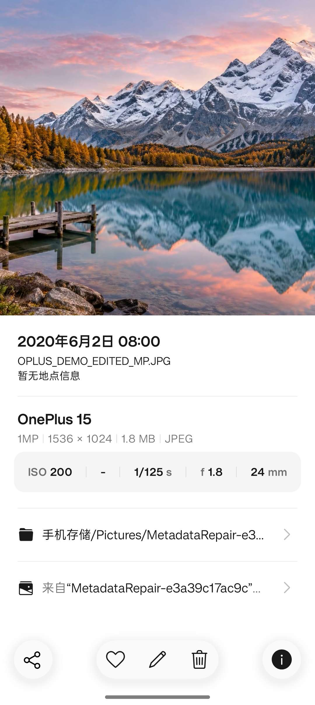
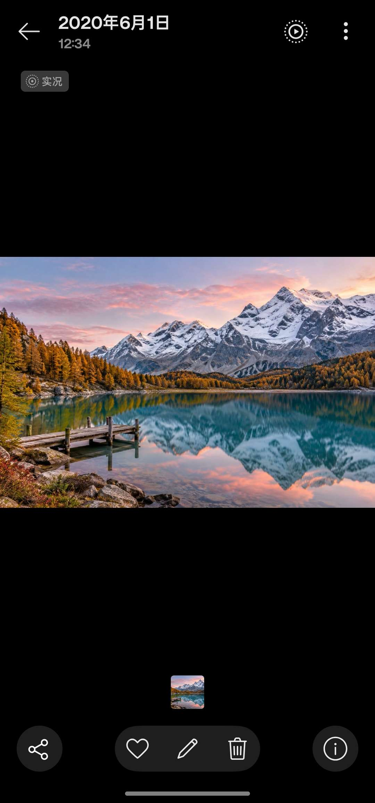
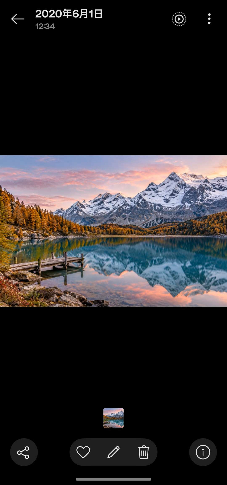

# OnePlus 复合 JPEG：标准 EXIF 之外的四层结构

本文是对一对原始/调时后文件的字节级比较，以及公开解析器实现的说明，不是 OPPO 官方格式规范，也不包含私人样本、地点、原日期或原文件名。所有时间例子均使用人工设置的 2020 年日期。

## 1. 调整拍摄时间：改当前值，另存旧值

比较的文件中同时出现了三件事：

1. 主图的 DateTimeOriginal、CreateDate、IFD0 ModifyDate 被改为新时间，DateTimeOriginal 的亚秒也发生变化。
2. OnePlus 尾部新增 capture.info.backup，其中包含 originalDateTakenMs 与 originalFileName。
3. 尾部签名从 jxrs 变成 wtmk，JSON 目录及若干偏移被重建。

备份里的毫秒时间戳经过时区换算，与改前 EXIF 拍摄时间吻合；备份文件名也与改前基名吻合。它是**保存旧值的备份**，不是给新日期提供优先级的覆盖字段。

概念上更接近：

```python
backup = {
    "originalDateTakenMs": original_capture_epoch_ms,
    "originalFileName": original_basename,
}
# 随后修改主图 EXIF 里的当前拍摄时间。
# 相册是否提供“恢复”按钮，是另一个需要实测的应用行为。
```

对这对文件，主 JPEG 的扫描数据和既有厂商尾部数据块逐字节保持一致；但部分非时间 EXIF 字段也出现差异。因此不能把相册调时视为“只新增一个字段”，更不能直接承诺所有元数据始终原样保留。

## 2. 文件扩展名是 JPEG，不代表里面只有一张图

观察到的结构可以概括为：

```text
主 JPEG：SOI / EXIF / XMP / MPF / ICC / 调试段 / 压缩扫描 / EOI
增益图 JPEG：用于 HDR 的另一张图
主 MP4：实况视频
厂商数据块：内嵌图、子视频、模式、预设、调时备份等
JSON 目录 + NUL
四字节尾标记 + 四字节小端目录长度
```

主图 EXIF 回答“这张图的型号、时间、曝光是什么”；XMP 提供实况与容器描述；MPF/HDR 信息描述增益图；厂商尾部承载进一步的媒体和编辑状态。它们需要分别检查。

标准 Motion Photo 并不要求拥有这里全部的 OnePlus 私有块。[Android Motion Photo 规范](https://developer.android.com/media/platform/motion-photo-format) 说明了静态图、附加视频及 XMP 的分工；厂商扩展是另一层约定。

## 3. 尾部目录怎样找到 payload

ExifTool 的 [Trailer.pm](https://github.com/exiftool/exiftool/blob/master/lib/Image/ExifTool/Trailer.pm) 是可核对的公开实现。对已观察布局，目录偏移从 JSON 起点向后回溯，不是从文件头向前计数。

```python
json_len = little_endian_u32(file[-4:])
json_start = len(file) - json_len
block_start = json_start - entry["offset"]
block_end = block_start + entry["length"]
payload = file[block_start:block_end]
```

json_len 包含 JSON、末尾 NUL 和最后八字节的 footer。每块仍必须通过边界、重复名称和重叠检查，不能用 Python 宽松切片掩盖无效偏移。

本次核对的 ExifTool 13.59 会按 jxrs 检测 OnePlus 尾部；wtmk 并未被同一路径识别。于是调时后字段列表里不再出现 OnePlus:JSONInfo，并不能证明原厂数据块被删除。仓库解析器显式支持这两种尾标记，并且只对观察过的布局作保证。

private.emptyspace 在样本里也不是可随手删除的空白：它含有一个长度值。调时后这个值还可能保持旧值，因此读取时不能只相信这一个总长度提示；应该以有边界校验的目录定位数据。

## 4. 大师模式：模式字符串、预设与功能位

尾部中存在：

- capture.mode：本例值为 master 加 NUL。
- master.mode.preset.info：一份固定长度的二进制设置数据。
- EXIF UserComment：形如 oplus_ 加整数的功能位集合。

这些是**共存事实**，不是已经证明“任意一个字段都能单独点亮大师标签”。UserComment 的完整位定义、预设各槽位的语义，以及相册的所有显示条件尚未解码，不应发明一个通用 MasterMode=1 标签。

实验构造器的 --example-master-preset 用非个人的设置字面值重建一份已观察布局，不读取私人图片里的任意预设。这个实验夹具不能证明跨版本兼容，更不会执行相机的大师模式图像处理。

## 5. 实况：图标、视频和偏移是不同问题

这对文件的 XMP 包含标准的 GCamera:MotionPhoto、MotionPhotoVersion、MotionPhotoPresentationTimestampUs，以及 OpCamera 命名空间下的：

- MotionPhotoOwner
- OLivePhotoVersion
- VideoLength
- MotionPhotoPrimaryPresentationTimestampUs

Google 标准命名空间为 http://ns.google.com/photos/1.0/camera/，厂商命名空间为 http://ns.oplus.com/photos/1.0/camera/。前缀只是 XML 的短名，URI 才标识属性所属命名空间。

Container:Directory 用 Primary、GainMap、MotionPhoto 等 item 描述拼接顺序与长度。在观察样本中，MotionPhoto 项的长度包含主视频与后续厂商尾部；OpCamera:VideoLength 则只表示主视频部分。还有 live.subVideo 与 live.subVideoSize，承载另一段视频。

因此，改写 XMP、增删尾部块后，必须重新计算这些长度。把旧数字照抄到另一张图上，会出现“标记存在，但视频定位错误”。

MotionPhotoPresentationTimestampUs 的单位是微秒，而 originalDateTakenMs 是 Unix 毫秒；一个指视频中哪一帧对应静态图，另一个表示历史拍摄时刻，不能互相替代。实验样本使用视频 1.5 秒处的画面作为主图。

## 6. ProXDR / HDR 不能靠复制名字完成

原容器有 HDR 增益图和相关参数。增益图本身包含图像内容，复制私人照片的增益图，即使主画面换了，仍可能泄露旧画面。

HDR 正确显示还取决于匹配的增益图、颜色信息、元数据和解码流程。模式名、标签或图标都不能单独证明新照片具备同样动态范围。此次新场景样本不合成假的 HDR 增益图，也不宣称产生 ProXDR 成片。

## 7. 新场景实验：避免“换了封面，里面还是原视频”

可公开复现的构造方法是：

1. 全新生成一个非私人场景，并制作无音轨 MP4。
2. 从视频中的指定时刻提取静态主图，在普通 JPEG 上设定需要的标准 EXIF。
3. src.image 写入同一新场景的图，live.subVideo 写入新生成的短片，不从私人样本提取媒体。
4. 模式名与已审查的通用设置重建；未知调试块、个人位置、原文件名等不导入。
5. 重新构建 JSON 目录、尾部长度、XMP 容器项及视频长度。
6. 用另一套读取路径检查长度、像素、音轨、视频解码与手机界面。

仓库中的 oplus_metadata.py 可检查普通图片和复合容器：

```powershell
python oplus_metadata.py inspect 'D:\Photos\sample.jpg'
```

默认摘要只输出结构、块名称、长度和备份是否存在，不输出备份里的旧日期或文件名。

实验构造器示例：

```powershell
# 可选：用 FFmpeg 从一张自己的新场景 JPEG 生成无声变焦短片
# 以下尺寸适合 3:2 场景；在空的新工作目录执行，避免覆盖已有文件
ffmpeg -i 'D:\Lab\scene.jpg' -vf "zoompan=z='1+0.0008*on':x='iw/2-iw/zoom/2':y='ih/2-ih/zoom/2':d=90:s=1536x1024:fps=30" -t 3 -an -c:v libx264 -pix_fmt yuv420p -movflags +faststart -map_metadata -1 'D:\Lab\video.mp4'
ffmpeg -ss 1.5 -i 'D:\Lab\video.mp4' -frames:v 1 -q:v 2 'D:\Lab\image.jpg'
ffmpeg -i 'D:\Lab\video.mp4' -t 0.8 -vf scale=768:512 -an -c:v libx264 -pix_fmt yuv420p -movflags +faststart -map_metadata -1 'D:\Lab\short.mp4'

# image.jpg 必须是没有旧实况/HDR 尾部的普通新场景 JPEG
# video.mp4 和 short.mp4 均应来自同一新场景；不要拿私人原视频来配一个新封面
python oplus_metadata.py build --image 'D:\Lab\image.jpg' --video 'D:\Lab\video.mp4' --sub-video 'D:\Lab\short.mp4' --output 'D:\Lab\DEMO_MP.jpg' --capture-mode master --presentation-us 1500000 --example-master-preset --oplus-flags 0xb00a00500
```

如需主动试验 UserComment 功能位，可显式提供 --oplus-flags；没有默认复制模板，也没有声称已经解释该整数全部含义。调时备份可用 --backup-time 和 --backup-name 配套构建；wtmk 通过 --footer 显式选择。实验 CLI 的结构校验不替代视频解码及手机验证。

## 8. 当前验收边界

新场景已在 ACE 3V 实际打开：OnePlus 15、两份不同的人工设定日期、ISO 200、f/1.8、1/125 秒、24 mm 正常显示。改时版显示当前 EXIF 时间，没有被备份旧时间覆盖。



主视频三秒、子视频约 0.8 秒，无音轨；提取出来能正常解码。主图与内嵌图的像素均来自全新场景，不含私人样本画面。

第一版未出现实况入口。保持主图扫描、视频和尾部不变，修正 XMP 命名空间声明的层级后，v2 在 ACE 3V 相册 16.40.22 出现实况标识；长按后可见同一场景短片的变焦变化。主样本和 wtmk 改时样本都显示入口。H.264、无音轨、没有增益图的配置保持不变，所以不能再把缺少入口归因于必须使用 HEVC、AAC 或 HDR。





### XMP 序列化对照

下表所有变体均使用相同视频、尾部数据与主 JPEG 扫描，属性值不变；每次以新文件名导入独立目录。

| 写法 | ACE 3V 实况入口 |
| --- | --- |
| ElementTree 默认：所有声明在 x:xmpmeta | 无 |
| 仅把 EXIF APP1 排在 XMP APP1 前面 | 无 |
| 只将 GCamera、OpCamera 声明移到 rdf:Description | 无 |
| 四组声明移到 rdf:Description，rdf 仍在外层 | 无 |
| 四组声明在 rdf:Description，rdf 声明在 rdf:RDF | 有 |
| 相机风格 XML、XMP APP1 仍放在 EXIF 前面 | 有 |
| 相机风格 XML 去掉 x:xmptk 工具名 | 有 |

四组指 GCamera、OpCamera、Container、Item。它们的 URI 见上文；代码保持 ElementTree 转义后的值，只重新放置声明。这里确定了一套充分的兼容写法，没有穷举所有排列，也没有取得相册源码，不能推断其内部具体判断语句。XML 命名空间继承在标准上有效；此现象不能改写成 XML 标准限制。

一加 15 已由使用者截图确认第一版的大师标识、广角文字、EV 和日期备份入口；v2 在一加 15 的实况结果尚待反馈。

### 复原后的实际文件

随后拿到实际点击“复原”后导出的文件，读回确认 DateTimeOriginal、CreateDate、ModifyDate 已恢复到 2020:06:01 12:34:56，SubSecTimeOriginal 恢复为 123。capture.info.backup 仍在，既有尾部块与主 JPEG 扫描数据保持不变。这次已经验证到文件写回，而不仅是按钮出现；复原也不等于删除编辑历史。

### 第二份原生长焦样本

原生长焦实况在 ACE 3V 有入口；其尾部有 live.subVideo、live.subVideoSize，但没有 master.mode.preset.info 或 src.image。它说明不能把大师样本的全部块都称为实况的必要字段。我们没有把这份私人图片、增益图、声音或视频用于新场景。

LensModel、FocalLength、FocalLengthIn35mmFormat 与 DigitalZoomRatio 语义不同。镜头文字、物理实际焦距、等效视角和数码裁切应分开解释；相册的显示优先级仍需按版本实测。
