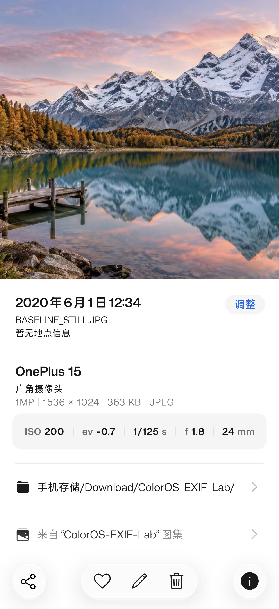
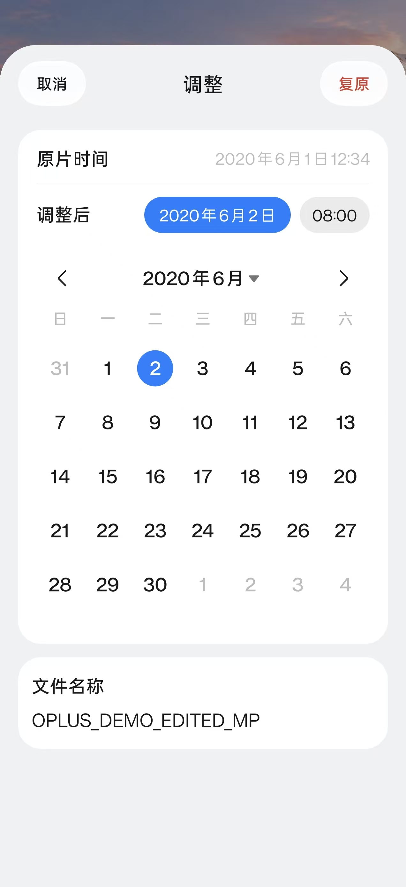

# ColorOS 相册兼容性

本页补充教程的适用范围。测试环境：OnePlus Ace 3V、Android 16 / API 36、系统相册 com.coloros.gallery3d 16.40.22，ExifTool 13.59，Python 3.12。测试日期：2026-10-28。

## 已在实际详情页看到的字段

| 内容 | 写入值 | 详情页结果 |
| --- | --- | --- |
| 自定义型号 | IFD0:Model = ColorOS EXIF Demo | ColorOS EXIF Demo |
| 拍摄日期 | DateTimeOriginal / CreateDate / ModifyDate = 2020:06:01 12:34:56 | 2020 年 6 月 1 日 12:34 |
| 时区 | OffsetTimeOriginal 等 = +08:00 | 日期保持目标本地时间；界面没有单独显示时区 |
| 地点 | GPS 39.9087, 116.3975 | 北京市、东城区等地址文本 |
| 感光度 | ISO = 200 | ISO 200 |
| 光圈 | FNumber = 2.8 | f 2.8 |
| 快门 | ExposureTime = 0.008 秒 | 1/125 s |
| 焦距 | FocalLength = 35；FocalLengthIn35mmFormat = 50 | 50 mm |
| 曝光补偿 | ExposureCompensation = -0.7 | 标签读回存在；此版本界面仍为“−” |

制造商 Demo、镜头标签、GPS 高度、毫秒和秒的完整显示没有获得同等界面验收，不能把字段可写等同于界面逐项展示。GPS 字符串由相册的地址服务解析，不等同于 EXIF 内存在同一地址文字。示例坐标不代表操作者或原照片的真实位置。

## 原图保护

本次演示从 NASA 下载公开 JPEG，原文件没有相机与 GPS 字段。使用仓库的一键入口和演示预设生成新副本后，原输入 SHA-256 保持不变；JPEG 扫描数据哈希保持不变；全部请求字段读回通过；复制到手机后的文件 SHA-256 与输出一致。

完整截图：[修改前](images/before-full.jpg)、[修改后](images/after-full.jpg)。人工审查确认只含公开地球图、教学设定值、通用测试目录和相册界面，无个人通知、账号、私人照片或真实个人位置，因此未作遮挡。它们不是 AI 模拟界面。

[EXIF 示意图](images/exif-layers.png) 由 AI 生成，图内已注明“非实机截图”，用于说明概念，不能当作测试证据。

## 可复现性与范围

电脑脚本的测试样本是动态生成的纯色 JPEG，测试涵盖批量与子目录、单字段/完整预设、GPS 方向和高度、时间与亚秒、无关标签和像素保留、非法参数拒绝、输出目录隔离及中文文件名。

当前批量工具只处理 JPEG/JPG，不对 HEIC、PNG、MP4 或不同版本相册做成功保证。旧教程中涉及的视频字段与时间体系需要单独处理。

## 复合 JPEG 的扩展验证

新增 `oplus_metadata.py`，识别 JPEG EOI、XMP 目录及观察到的 jxrs / wtmk OnePlus 尾部。标准批处理检测到复合容器时跳过，不重写隐藏媒体。单元测试增加尾标记、反向偏移、越界拒绝、备份摘要脱敏、实况目录长度及复合文件保护。

新的全合成山湖样本中，主图与内嵌图像素一致，主视频三秒且可以完整解码，无音轨；子视频同样来自新场景。两种尾标记的目录边界均通过检查。它们不包含用于格式比较的私人画面、地点、原时间、原文件名、视频或音轨。

ACE 3V 已打开主样本与改时版：日期分别为 2020-06-01 12:34 与 2020-06-02 08:00，机型与摄影参数正常；改时版未显示备份的旧日期。未观察到大师/实况入口，因而没有相册内播放验收。

## 一加 15 用户复测

以下证据来自使用者提供的三张截图与“除了实况没有，其他如期出现”的反馈。确切的系统和相册版本尚未提供；不能仅以设备型号解释机制差异。

| 内容 | 截图或反馈所支持的结论 |
| --- | --- |
| 普通静态对照 | 显示 OnePlus 15、广角摄像头、ev -0.7 和设定时间 |
| 复合主样本 | 在上述信息外显示 PRO 相机图标，即大师标识 |
| 改时版调整页 | 同时显示原片时间 6 月 1 日 12:34、调整后 6 月 2 日 08:00，以及复原按钮 |
| 实际点击复原后的写回 | 尚无文件回读或操作完成截图，不记为已验证 |
| 实况入口/播放 | 使用者反馈仍未出现，不记为成功 |

普通对照也能显示 EV，排除了“必须加入厂商尾部才可能显示该 EV 值”的说法。大师标识只验证整套字段组合的兼容性，尚未隔离各字段的单独作用。视频结构与解码通过不代表相册已经识别实况。
