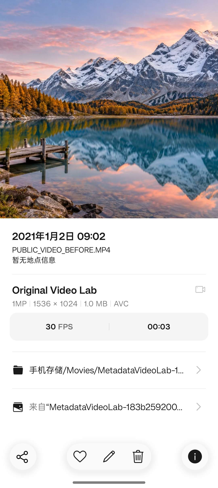
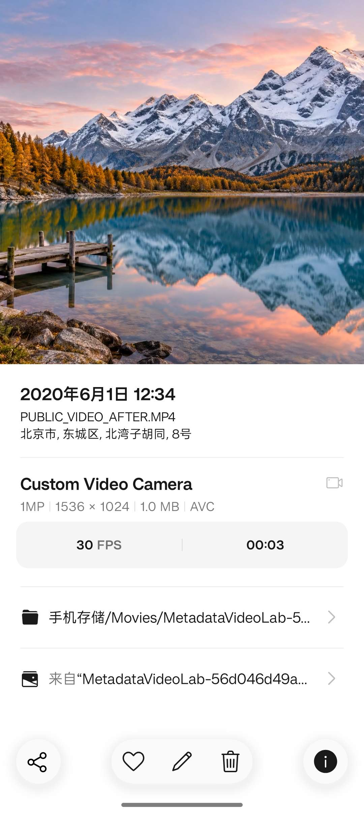

# 视频元数据实验：机型、UTC 时间与定位

本页记录 2026-10-28 的 MP4 实测。设备为 OnePlus Ace 3V，Android 16，相册 16.40.22，ExifTool 13.59。测试使用一段经所有者授权的原生 HEVC/AAC 视频，公开截图另用无声的合成山湖视频复现；私人原片、音轨、原定位和日志不公开。

## 已观察到的显示规则

每份变体复制到独立手机目录，等待媒体扫描后重新打开详情，并核对文件名。下表是这个版本的观察结果，不是所有 Android 相册的通用规范。

| 控制变量 | 实际结果 |
| --- | --- |
| 原有 OplusProductModel 保留，新增 Keys:Model | 显示新 Model |
| 只新增 Keys:AndroidModel | 仍显示原 OplusProductModel |
| 只修改 Keys:OplusProductModel | 显示新私有机型 |
| 三个机型字段分别写不同值 | 显示 Keys:Model |
| 删除 OplusProductModel，只留 AndroidModel | 无相机信息 |
| 只改 QuickTime:CreateDate，轨道日期保持旧值 | 详情日期跟随新的电影头时间 |
| 六组电影、轨道和媒体时间统一写 UTC | 显示相应北京时间 |
| 新增不同的 Keys:CreationDate，电影头日期保留 | 仍显示电影头日期 |
| 修改 UserData:GPSCoordinates | 根据新坐标解析地址 |
| 新增 Keys:GPSCoordinates，原 UserData 定位保留 | 仍显示原 UserData 对应地址 |

因此，对本组样本，机型观察到 `Keys:Model > Keys:OplusProductModel`；没有证据表明 AndroidModel 能独立驱动此版本的相机信息。定位对照没有穷举缺失字段的回退规则。

## 读字段时保留分组

```powershell
$src = 'D:\VideoLab\source.mp4'
exiftool -a -G1 -s -Model -AndroidModel -OplusProductModel -time:all -GPSCoordinates $src
```

MP4 的 mdta 键、UserData 与电影/轨道头不是 JPEG 的 IFD。`com.oplus.product.model` 在本机 ExifTool 中可读，但没有内置写入定义，因此仓库提供最小配置 `profiles/oplus-video.config`。它只声明这个键，不从私人视频复制任何数据。

## 自定义机型：写新副本

```powershell
exiftool -o 'D:\VideoLab\model-keys.mp4' '-Keys:Model=My Video Camera' $src

# -config 必须放在 ExifTool 的实际命令行前部；不能塞进 -@ 参数文件
exiftool -config profiles/oplus-video.config -o 'D:\VideoLab\model-oplus.mp4' '-Keys:OplusProductModel=My Video Camera' $src
```

输出名必须是新文件。不同字段并存时会影响显示优先级；主动统一机型可显式同步三处，但这不能证明真实拍摄设备。不要只改 AndroidModel 就认定相册会跟着改变。

## 时间：先把带时区的目标换算到 UTC

目标北京时间 `2020-06-01 12:34:56+08:00` 对应 UTC `04:34:56`。本例直接把 UTC 数值写入电影、轨道与媒体头，不启用依赖电脑本地时区的 QuickTimeUTC 转换：

```powershell
$utc = '2020:06:01 04:34:56'
exiftool -o 'D:\VideoLab\time.mp4' `
  "-QuickTime:CreateDate=$utc" "-QuickTime:ModifyDate=$utc" `
  "-QuickTime:TrackCreateDate=$utc" "-QuickTime:TrackModifyDate=$utc" `
  "-QuickTime:MediaCreateDate=$utc" "-QuickTime:MediaModifyDate=$utc" $src
```

ExifTool 默认读取这些整数时间时可能不作本地换算。文件里读到 04:34、手机显示 12:34，可以是同一个时刻。不要先写本地 12:34，再被手机额外加八小时。字符串日期如 Keys:CreationDate 又是另一套表示，不能混用。

## 定位：这里用 ISO 6709 坐标串

```powershell
exiftool -o 'D:\VideoLab\location.mp4' '-UserData:GPSCoordinates=39.9087 116.3975' $src
```

ExifTool 将输入转换为容器里的 ISO 6709 表示；它不是 JPEG 的 GPSLatitude/GPSLongitude 四件套。示例坐标为公开的北京地区教学值，地址由相册解析，不能保证每个版本返回相同门牌。修改一处定位也不等于清除了视频中所有历史、定时或厂商定位，发布私人媒体仍需单独审查。

## 可复现的五份副本实验

安装 Python、ExifTool、FFmpeg（含 ffprobe），在仓库根目录运行：

```powershell
python scripts/video_lab.py 'D:\VideoLab\source.mp4' --output 'D:\VideoLab\trial-01'
python scripts/video_lab.py 'D:\VideoLab\source.mp4' --output 'D:\VideoLab\trial-01' --apply
```

第一条仅预览；第二条要求全新的输出目录。五份文件分别为 MODEL_KEYS、MODEL_ANDROID、MODEL_OPLUS、TIME_LOCATION、CUSTOM_VIDEO。脚本固定使用演示机型、2020 年时间和北京坐标，**用于字段实验，不会自动恢复真实信息，也不是视频库批量修复工具**。

report.json 记录源文件哈希及逐个音视频包的内容、PTS、DTS、时长、大小是否一致。任一包不一致会报错；失败产物保留供排查，不记为成功。报告和输出仍可能携带私人媒体或未改字段，不应直接公开。容器整体哈希会改变；压缩媒体包不变并不意味着所有未知元数据都逐字节不变。

实验脚本不自动验收相册显示；写完必须用 ExifTool 读回，再以原文件复制到手机的新目录，等待扫描后核对详情。不要覆盖旧文件后只看缓存。

## 真实公开对照

下面两张都是系统相册全屏截图，画面来自同一段 AI 山湖短片。机型、日期及修改后的 GPS 均为演示设定；没有使用私人原视频的画面或音轨。





原生 HEVC/AAC 对照的压缩媒体数据包内容与时间戳一致、完整解码通过；组合副本的机型、日期、地址、HEVC、60 FPS、三秒时长已在相册核对。公开 H.264 无声视频也复现了机型、时间、定位显示。一加 15 与其他相册版本尚未进行此次视频复测。

参考：[ExifTool QuickTime 标签表](https://exiftool.org/TagNames/QuickTime.html)、[QuickTime 解析源码](https://github.com/exiftool/exiftool/blob/master/lib/Image/ExifTool/QuickTime.pm)、[写入实现](https://github.com/exiftool/exiftool/blob/master/lib/Image/ExifTool/WriteQuickTime.pl)。上述优先级来自实机对照，不是由字段名推断。
